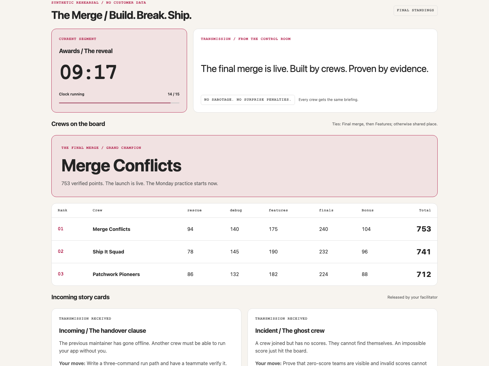
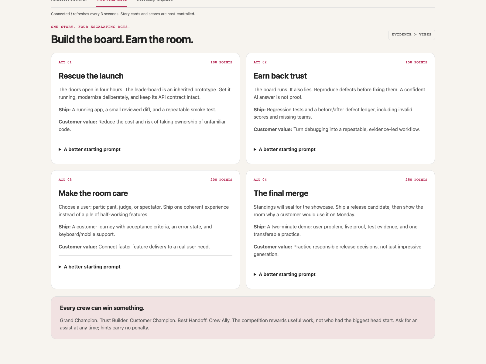
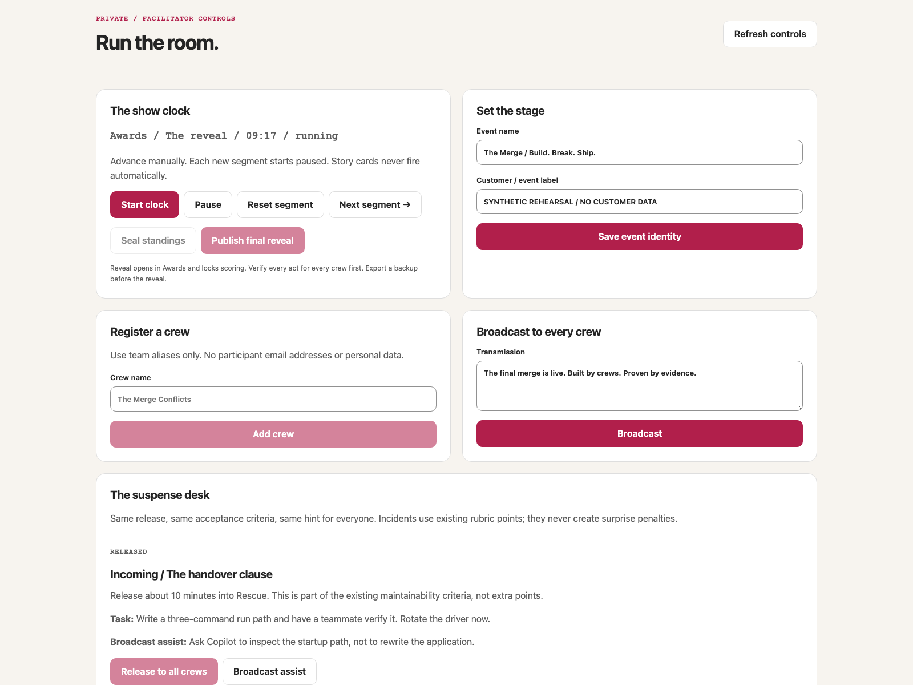
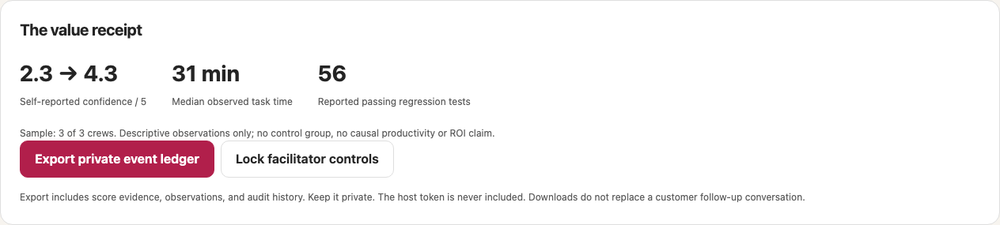

# The Merge / Customer engagement kit

Use this to scope, invite, prepare, and repeat a four-hour value-based delivery.
The package is reusable; customer readiness is not automatic.

## What the room sees

These are captures from the running event app using synthetic rehearsal data only.
The public board keeps the shared clock, verified standings, and released story
cards in one place; private evidence and facilitator controls stay off the projector.

*The live experience: one shared clock, visible proof, and a final reveal.*

Preview the missions, facilitator desk, and evidence handoff

<table>
  <tr>
    <td width="50%" valign="top">
      
      
<strong>Participant journey:</strong> four escalating acts, each with a shippable deliverable.

    </td>
    <td width="50%" valign="top">
      
      
<strong>Facilitator view:</strong> run the clock, release story cards, and manage evidence.

    </td>
  </tr>
</table>

*The value receipt keeps sample size and measurement limits visible; it makes no causal productivity or ROI claim.*

## Engagement brief / fill with the sponsor

| Field | Agreement |
|---|---|
| Customer + date + venue/time zone | |
| Sponsor and delivery lead | |
| Audience / crew count / experience mix | |
| One real workflow friction | e.g. Regression tests are skipped during urgent fixes |
| Success hypothesis | e.g. Crews can reproduce a defect, verify a fix, and explain their tests |
| Evidence to collect | Reviewed artifact, test proof, crew confidence, one observed task time |
| Business context | Why this workflow matters; no assumed dollar savings |
| Approved Copilot account/plan and feature availability | |
| Data boundary / export retention / customer custodian | Synthetic data and crew aliases only |
| Access and network owner | |
| Accessibility accommodations and pairing needs | |
| 14-day follow-up owner and date | |

Do not convert task completion time into "hours saved" without a comparable baseline
and a credible measurement design. A before/after confidence survey is self-report,
not operational evidence.

## Readiness gate / no-go until resolved

| Gate | Proof |
|---|---|
| Access | Every crew can open approved Copilot assistance; quota/permissions and fallback checked |
| Runtime | Every crew can install and start a synthetic starter copy under Node.js 22+ |
| Delivery | Lead has rehearsed all controls, restart recovery, scoring, export, and reveal |
| Network | Public board reachable on approved network; TLS/access boundary approved for remote delivery |
| Judging | Named judges, published rubric, assigned crew coverage, demo order and disputes policy |
| Safety | No customer code, credentials, personal records, or real-system faults in exercise data |
| Inclusion | Keyboard/narrow screen and reduced-motion needs checked; roles rotate; hints free |
| Follow-through | Sponsor has a hypothesis, evidence custodian, and 14-day review appointment |

Plan 4-8 crews with 2-4 people each. Add a technical/judging assistant for each four
crews. Above eight crews use the runbook's gallery format, additional judges, and a
network rehearsal. Do not promise the same staffing model at arbitrary scale.

## Participant invitation / customer-editable copy

**Subject: The Merge — your crew, four hours, one launch worth saving**

The leaderboard is missing. The prototype is suspicious. Your crew is the recovery plan.

Join us for **The Merge / Build. Break. Ship.** on **[date/time/time zone]** at **[venue/link]**.
You will rescue a broken app, investigate its lies, build a customer experience,
and ship a demo with GitHub Copilot beside you. Expect shared story twists, useful
challenges, crew assists, and a final board reveal.

Bring a laptop, **Node.js 22+**, **your approved editor/Copilot access**, and curiosity.
Complete **[readiness instructions]** before **[deadline]**. We will use synthetic code
and data, not customer repositories. No advanced AI expertise required; crews pair
and rotate roles.

You leave with a verified artifact and one practice to try on Monday.
**[RSVP channel, access support contact, accommodation channel]**

## Sponsor talk track / 60 seconds

> "Today is not a claim that AI solves every engineering problem. It is a chance to
> practice one better workflow. Our friction is [workflow]. We will look for
> [evidence]. We will review [safe experiment] after 14 days. The code can be playful.
> The habit we take back should be real."

## Crew card / print or keep locally

| Item | Crew entry |
|---|---|
| Crew alias / chosen user | |
| Baseline confidence / 1-5 | |
| Named observed task / start-stop minutes | |
| Three defect reproductions / matching passing tests | |
| User acceptance / recovery proof | |
| Final confidence / 1-5 | |
| Passing regression-test count | |
| Monday practice / owner alias / review date | |
| Known limitation | |

Collect aggregate crew observations, not individual employee ratings. Keep code and
full test artifacts in customer-owned locations; the event ledger needs only a
synthetic verification note, not copies of repositories.

## Post-event handoff

| Timing | Deliverable |
|---|---|
| Same day | Exported private ledger + sponsor value receipt; verify no sensitive contents |
| Within 2 business days | Customer-owned artifacts, appreciation citations, unresolved gaps, agreed experiment |
| Day 14 | Review adoption evidence and friction; decide expand, adjust, or stop |

The lead fills [VALUE-RECEIPT.md](VALUE-RECEIPT.md). Obtain customer approval before
sharing any customer-specific results, photos, quotes, or artifacts outside the
agreed audience. Marketing claims require evidence and consent, not enthusiasm.
